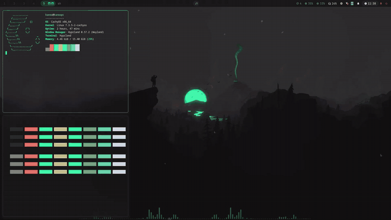

<p align="center">
  
</p>

<p align="center">
  <strong>Hyprland for Arch Linux &amp; CachyOS — one install, then a live GTK4 settings app.</strong>
</p>

<p align="center">
  <a href="https://github.com/KaNEX-01/souprland/actions/workflows/test.yml"></a>
  
  
  <a href="LICENSE"></a>
</p>

<p align="center">
  
</p>

<p align="center">
  <sub>80 palettes · 49 profiles · 66 bar layouts · 15 desktop widgets · 324 settings · 105 bindings · 83 components in 20 categories</sub>
</p>

---

## Install

```bash
git clone https://github.com/KaNEX-01/souprland.git
cd souprland
./install.sh
```

Then open the settings app anytime with **`SUPER + I`** (or `souprland`). Everything is backed up automatically — roll back with `./restore.sh`.

- **Live GTK4 control** — One config file (`~/.config/hyprsetup/settings.conf`), instant reload, no root prompts.
- **Profiles & Soup Maker** — Pick from 49 profiles (31 native + 18 community rices), import any dotfiles repo by URL, or mix parts across setups while keeping your keybinds.

---

<!-- intro:start — generated from assets/intro/pages.json, do not edit by hand -->

### What is Souprland?


An installer that sets up a Hyprland desktop from scratch, and a settings app that takes over after installation.

- Theme, bar, terminal, launcher, keybinds: all from this window, applied instantly.
- Ready-made desktops install in one click and can be rolled back.
- Your keybinds stay the same on every theme.

### This Project Is Made With AI And Can Be Buggy As Hell


Souprland is basically a script that controls Hyprland with a GUI.

- You can use ready-made dotfiles,
- make your own with the setup wizard,
- or mix dotfiles together with Soup Maker.

If you see any bug, please open an issue on GitHub. I'll do my best to fix it.

### No bloat


By default you only get what a desktop needs. No AUR, no extras.

Want more? You choose it, nothing gets installed behind your back.

The repo is a bit big (~100 MB) because of the themes and wallpapers inside, but they just sit there until you use them.

### Security


There are dotfiles using AUR packages, and some features also need AUR. It is up to you to choose whether to use them or not. All settings and dotfiles that use AUR can be seen in the GUI.

#### AUR packages

As always with AUR, review PKGBUILDs before installing.

#### Third-party dotfiles

Some dotfiles include configs and scripts from other authors. So review them before use.

### Credits

Thanks to the authors whose dotfiles and scripts are used in this project:

- [0xbbuddha/dotfiles_nothing_os](https://github.com/0xbbuddha/dotfiles_nothing_os) – dotfiles for the NothingOS profile (MIT)
- [ad1822/hyprdots](https://github.com/ad1822/hyprdots) – dotfiles for the ad1822 profile (MIT)
- [arfan-on-clouds/hyprclouds](https://github.com/arfan-on-clouds/hyprclouds) – dotfiles for the hyprclouds profile (no license stated)
- [Brainitech/Brain_Shell](https://github.com/Brainitech/Brain_Shell) – dotfiles for the Brain Shell profile (MIT)
- [caelestia-dots/caelestia](https://github.com/caelestia-dots/caelestia) – used by the Caelestia profile (no license stated)
- [caelestia-dots/cli](https://github.com/caelestia-dots/cli) – used by the Caelestia profile (no license stated)
- [caelestia-dots/shell](https://github.com/caelestia-dots/shell) – dotfiles for the Caelestia profile (GPL-3.0)
- [dhrruvsharma/shell](https://github.com/dhrruvsharma/shell) – dotfiles for the dhruvsharma profile (no license stated)
- [end-4/dots-hyprland](https://github.com/end-4/dots-hyprland) – dotfiles for the end-4 profile (GPL-3.0)
- [end-4/google-sans-flex](https://github.com/end-4/google-sans-flex) – used by the end-4 profile (OFL-1.1)
- [end-4/rounded-polygon-qmljs](https://github.com/end-4/rounded-polygon-qmljs) – used by the end-4 profile (Apache-2.0)
- [haikal-hakim/athena-eww](https://github.com/haikal-hakim/athena-eww) – dotfiles for the Athena profile (MIT)
- [ilyamiro/hypr-comp](https://github.com/ilyamiro/hypr-comp) – used by the ilyamiro profile (no license stated)
- [ilyamiro/imperative-dots](https://github.com/ilyamiro/imperative-dots) – dotfiles for the ilyamiro profile (no license stated)
- [ilyamiro/serpantinum](https://github.com/ilyamiro/serpantinum) – dotfiles for the Serpantinum profile (AGPL-3.0)
- [k4ditano/k4](https://github.com/k4ditano/k4) – dotfiles for the k4 profile (MIT)
- [kianblakley/pibble](https://github.com/kianblakley/pibble) – dotfiles for the pibble profile (GPL-3.0)
- [r4ppz19/Arch-dotfiles](https://github.com/r4ppz19/Arch-dotfiles) – dotfiles for the r4ppz19 profile (MIT)
- [saatvik333/hyprland-dotfiles](https://github.com/saatvik333/hyprland-dotfiles) – dotfiles for the saatvik333 profile (no license stated)
- [samyns/Unit-3](https://github.com/samyns/Unit-3) – dotfiles for the Unit-3 profile (MIT)
- [simeulinuxkaliaiwr/vantage](https://github.com/simeulinuxkaliaiwr/vantage) – dotfiles for the Vantage profile (MIT)
- [zephardev/hyprcraft](https://github.com/zephardev/hyprcraft) – dotfiles for the HyprCraft profile (MIT)

<!-- intro:end -->

---

<details>
<summary><strong>Shortcuts, CLI &amp; installer options</strong></summary>

### Key shortcuts
| Shortcut | Action |
|---|---|
| `SUPER + I` | Settings app (floating panel) |
| `SUPER + SHIFT + W` | Quick Look (wallpaper strip + settings ring) |
| `SUPER + /` | Searchable keybinding cheatsheet |
| `SUPER + Return` / `SUPER` (tap) | Terminal / Launcher |
| `SUPER + A` / `SUPER + J` / `SUPER + F12` | Quick actions / Toggle bar / Game Mode |

### Installer & CLI
```bash
./install.sh --dry-run          # preview without changing anything
./install.sh --doctor           # read-only health check
./install.sh --update           # update while keeping settings.conf
./restore.sh --first            # restore to pre-Souprland state
./hyprsetup-gui                 # preview the settings app before installing

python3 -m hyprsetup rice list  # community rices (install / variant / import / uninstall)
python3 -m hyprsetup mix list   # Soup Maker CLI (set / save / load / clear)
souprland share export          # export look + wallpaper to .tar.gz
```

Static script-free configs for native profiles also live in [`dotfiles/`](dotfiles/) (`./dotfiles/install-dotfiles.sh --list`).

</details>

<details>
<summary><strong>Requirements, docs &amp; development</strong></summary>

- **Requires:** Arch Linux or CachyOS (run as a regular user, not root), `bash`, `python3`, `jq`, `gtk4`, `libadwaita`, `python-gobject`, `python-cairo`.
- **Tests:** `./tools/test.sh` (or `--quick`) · `./tools/build-dotfiles.sh --check`
- **Docs:** [Settings Guide](docs/settings-guide.md) · [Preset Sources](docs/preset-sources.md) · [Gallery Catalog](docs/gallery-catalog.md) · [Roadmap & Limits](docs/roadmap.md) · [VM Testing](docs/vm-testing.md)

</details>

---

<p align="center">
  <sub>Wallpaper Colors inspired by <a href="https://github.com/fhadiel/ricemood">ricemood</a> · <a href="LICENSE">MIT License</a> © kanex</sub>
</p>
